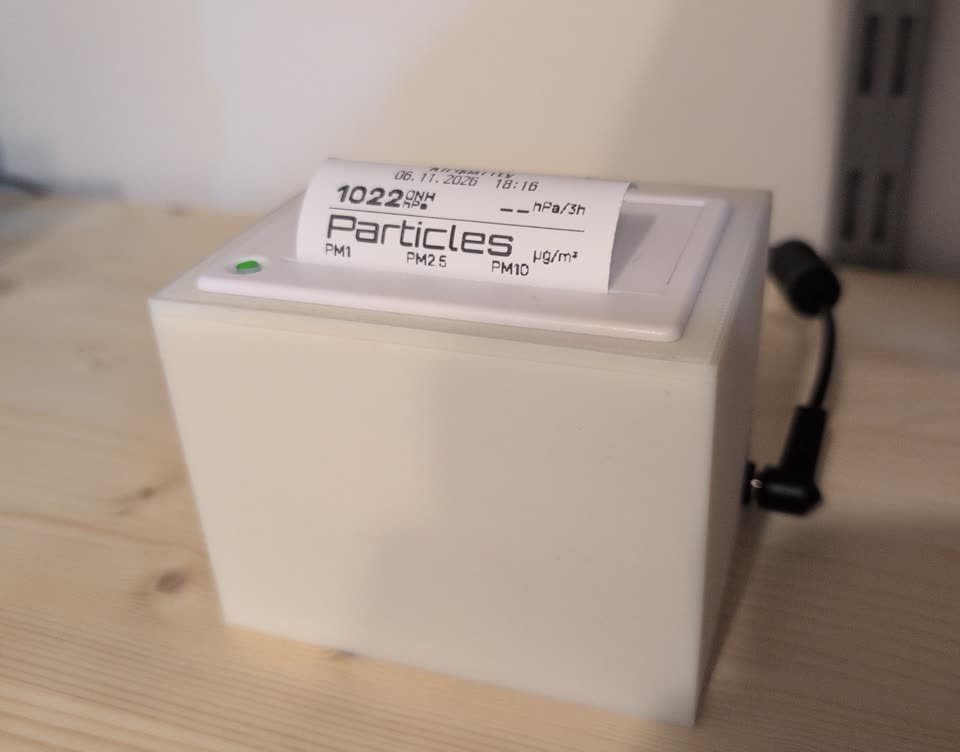

<!-- markdownlint-disable MD033 -->
<p align="center">
  <b>QR204 Printer Bridge</b><br>
  <b>Network bridge that turns a QR204 58 mm thermal printer into an ESC/POS network printer.</b><br>
  An ESP32-C3 serves raw TCP port 9100, so anything on the LAN can print: a Home Assistant action, a
  shell one-liner, or a sensor box sending its current screen. Printer status comes back as Home
  Assistant entities.
</p>

<p align="center">
  
</p>
<!-- markdownlint-enable MD033 -->

[![Release][badge-release]](https://github.com/Ajimaru/QR204-Printer-Bridge/releases/latest)
[![Downloads][badge-downloads]](https://github.com/Ajimaru/QR204-Printer-Bridge/releases)
[![Last commit][badge-last-commit]](https://github.com/Ajimaru/QR204-Printer-Bridge/commits/main)
[![Validate][badge-validate]](https://github.com/Ajimaru/QR204-Printer-Bridge/actions/workflows/validate.yml)
[![License: MIT][badge-license]](LICENSE)

[![ESPHome][badge-esphome]](https://esphome.io)
[![Platform][badge-platform]](https://www.espressif.com/en/products/socs/esp32-c3)
[![Printer][badge-printer]](datasheets/)
[![Home Assistant][badge-homeassistant]](https://www.home-assistant.io/)
[![Made with Love][badge-love]](https://github.com/Ajimaru/QR204-Printer-Bridge)

[badge-release]: https://img.shields.io/github/v/release/Ajimaru/QR204-Printer-Bridge?sort=semver&style=flat-square&logo=github&logoColor=white
[badge-downloads]: https://img.shields.io/github/downloads/Ajimaru/QR204-Printer-Bridge/total?style=flat-square&logo=github&logoColor=white&label=downloads
[badge-last-commit]: https://img.shields.io/github/last-commit/Ajimaru/QR204-Printer-Bridge?style=flat-square&logo=github&logoColor=white
[badge-validate]: https://img.shields.io/github/actions/workflow/status/Ajimaru/QR204-Printer-Bridge/validate.yml?style=flat-square&logo=githubactions&logoColor=white&label=validate
[badge-license]: https://img.shields.io/badge/license-MIT-lightgrey?style=flat-square&logo=open-source-initiative&logoColor=white
[badge-esphome]: https://img.shields.io/badge/ESPHome-2026.10-black?style=flat-square&logo=esphome&logoColor=white
[badge-platform]: https://img.shields.io/badge/platform-ESP32--C3-red?style=flat-square&logo=espressif&logoColor=white
[badge-printer]: https://img.shields.io/badge/QR204-58_mm_ESC%2FPOS-lightgrey?style=flat-square
[badge-homeassistant]: https://img.shields.io/badge/Home%20Assistant-ESPHome%20API-41bdf5?style=flat-square&logo=homeassistant&logoColor=white
[badge-love]: https://img.shields.io/badge/made_with-%E2%9D%A4%EF%B8%8F-ff69b4?style=flat-square

> [!WARNING]
> TCP port 9100 is the raw printing protocol and has **no authentication**: anyone who can reach the device
> can print. Keep it on a private LAN and do not forward the port — see the [security policy](SECURITY.md).

```text
Sensor box (ESP32-S2)  --WiFi, TCP port 9100, ESC/POS-->  ESP32-C3 bridge  --UART (TTL)-->  QR204
airquality                                                thermal-printer
```

## What it does

An ESP32-C3 is wired to the QR204's TTL serial port and runs an ESPHome configuration with a small C++ bridge. It
accepts ESC/POS jobs on raw TCP port 9100 — the usual network receipt-printer protocol — so anything on the LAN can
print: Home Assistant sends text through an action, `nc` works from any shell, and the [`airquality` sensor box](https://github.com/Ajimaru/Sensor-Box-Enhanced) — a separate project — sends its current screen as a bitmap.

Besides forwarding jobs it polls the printer for status (`DLE EOT 2`), exposes online/paper-out/error state
and job counters as Home Assistant entities, prints its own test page, reads the printer's firmware and
serial number, and drives an optional WS2812B status LED with a night mode computed from its own sun
position. A 64 KB UART ring buffer takes a whole screen print, so the sender is never throttled mid-job.

The printer's firmware deviates from its manual in several places, and it is permanently in GB18030 mode.
Both measured quirks and the character conversion that works around them are documented in the wiki.

## Installation

The firmware is compiled on your own machine; there is no prebuilt `.bin`, because the WiFi credentials and the
API key are compiled in. What you download is the ESPHome config bundle:

1. Download `QR204-Printer-Bridge-<version>.zip` from the [Releases page](https://github.com/Ajimaru/QR204-Printer-Bridge/releases) and unpack it.
2. Copy `secrets.yaml.example` to `secrets.yaml` and fill in the five values.
3. Put `thermal-printer.yaml`, `printer_bridge.h` and `secrets.yaml` in one folder and flash the ESP32-C3 with
   ESPHome (Device Builder, or `esphome run thermal-printer.yaml`).

Wiring, power supply and the first tests are in the wiki. Start with the
[Setup Guide](https://github.com/Ajimaru/QR204-Printer-Bridge/wiki/Setup-Guide) for the full steps and the [Assembly Guide](https://github.com/Ajimaru/QR204-Printer-Bridge/wiki/Assembly-Guide)
before powering anything up: both buck converters must be set with a multimeter first.

## Documentation

The complete build and maintenance documentation is in the wiki:

- [Features](https://github.com/Ajimaru/QR204-Printer-Bridge/wiki/Features) — what the bridge does, why it is built this way, and all Home Assistant entities.
- [Hardware & Printing Guide](https://github.com/Ajimaru/QR204-Printer-Bridge/wiki/Hardware-and-Printing-Guide) — parts list, printer connectors and pinouts, printable housing.
- [Assembly Guide](https://github.com/Ajimaru/QR204-Printer-Bridge/wiki/Assembly-Guide) — identifying the printer variant, power supply, wiring, pin map.
- [Setup Guide](https://github.com/Ajimaru/QR204-Printer-Bridge/wiki/Setup-Guide) — firmware flash, Home Assistant adoption, end-to-end test.
- [User Guide](https://github.com/Ajimaru/QR204-Printer-Bridge/wiki/User-Guide) — printing, status LED, tuning, troubleshooting.
- [Development Guide](https://github.com/Ajimaru/QR204-Printer-Bridge/wiki/Development-Guide) — bridge internals, measured firmware behaviour, ESC/POS job layout.
- [Security policy](SECURITY.md)
- [License](LICENSE)

`main` is protected: changes go through a pull request with passing checks. See
[Contributing changes](https://github.com/Ajimaru/QR204-Printer-Bridge/wiki/Development-Guide#contributing-changes).

The wiki pages are generated from [`docs/`](docs/) in this repository; see [Documentation and wiki sync](https://github.com/Ajimaru/QR204-Printer-Bridge/wiki/Development-Guide#documentation-and-wiki-sync).

## Repository layout

| Path | Purpose |
| --- | --- |
| [`esphome/thermal-printer.yaml`](esphome/thermal-printer.yaml) | ESPHome config of the C3 bridge |
| [`esphome/printer_bridge.h`](esphome/printer_bridge.h) | TCP port 9100 ↔ UART bridge, status polling, test page |
| [`esphome/secrets.yaml.example`](esphome/secrets.yaml.example) | Template for the `secrets.yaml` the config needs |
| [`datasheets/`](datasheets/) | QR204 manual (Chinese): pinout, ESC/POS command set |
| [`assets/`](assets/) | Photo of the finished bridge, used in the README and the hardware guide |
| [`Thermal Printer Housing/`](Thermal%20Printer%20Housing/) | Housing and lid STLs |
| [`docs/`](docs/) | Wiki source, published by the `wiki-sync` workflow |
| [`wiki/`](wiki/) | Wiki landing page and navigation templates, added once by hand |

The [`airquality` sensor box](https://github.com/Ajimaru/Sensor-Box-Enhanced) is a separate project with its own
repository. It is this bridge's biggest client, so the documentation refers to it, but nothing here depends on it: the
bridge is a plain network printer.

## License

MIT License — see [LICENSE](LICENSE). The printer manual in [`datasheets/`](datasheets/) is the
manufacturer's document, included for reference only.

Copyright © 2026 Ajimaru
