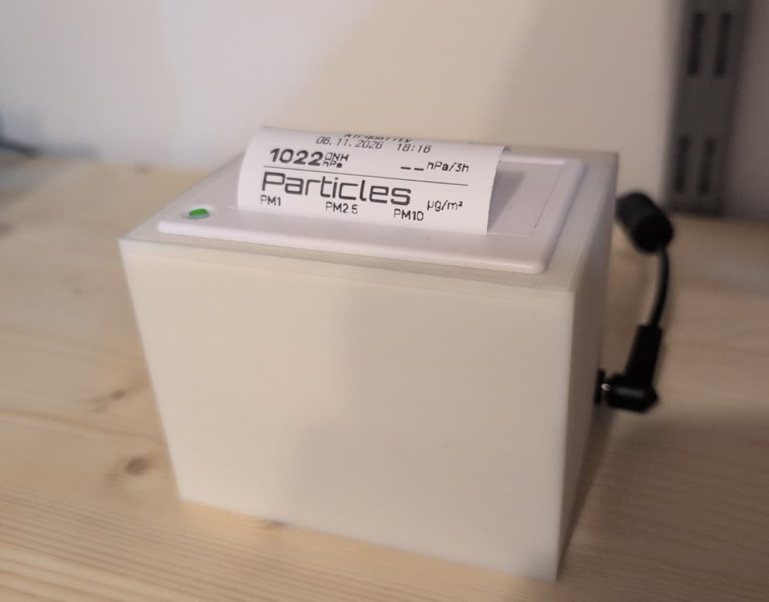

# QR204 Printer Bridge Hardware & Printing Guide

This guide lists what to buy and what to print before assembly. Continue with the
[Assembly Guide](https://github.com/Ajimaru/QR204-Printer-Bridge/wiki/Assembly-Guide) when the parts are ready.

## Parts

| Part | Notes |
| --- | --- |
| QR204 panel printer | 58 mm paper, 203 dpi, 384 dots per line, ESC/POS. Comes as a 5–9 V or a 12 V model, with a TTL or an RS232 serial port, plus USB. The one used here: label "Model: QR204, DC: 5-9V 2A+", USB & TTL |
| ESP32-C3 board | The one used here: Tenstar Robot ESP32-C3 Super Mini (ESP32-C3FH4, 4 MB embedded flash, native USB). Any C3 board that exposes GPIO6, GPIO7, 5V and GND works; pin table at the end of `thermal-printer.yaml` |
| Power supply 12 V, 3 A | Feeds both buck converters. 1.25 A (15 W) is too little: the printer alone peaks at ~18–20 W at 9 V |
| MP1584EN buck converter (3 A), set to 8.7–9.0 V | Printer supply. Not a Mini-360: the label says 2 A+, a Mini-360 only manages ~1.5–1.8 A continuous |
| Mini-360 buck converter, set to 5.0 V | C3 supply (at most ~0.4 A during WiFi transmit) |
| Electrolytic capacitor 470–1000 µF, 25 V | Required. At the printer's power connector, buffers the heating pulses |
| Electrolytic capacitor 100–220 µF, ≥ 16 V | Recommended. At the C3's 5V/GND pins, buffers WiFi transmit peaks (~350 mA) |
| Optional: electrolytic capacitor 470 µF, 25 V | At the converters' 12 V input, only needed with a long cable from the PSU |
| Optional: WS2812B RGB LED, single (bare or on a small breakout board) | Status LED on GPIO10, powered from the C3's 3V3 pin (see the [Assembly Guide](https://github.com/Ajimaru/QR204-Printer-Bridge/wiki/Assembly-Guide) and [Status LED](https://github.com/Ajimaru/QR204-Printer-Bridge/wiki/User-Guide#status-led)) |
| 58 mm thermal paper roll | |
| Cables | Use the printer's supplied cables (5-pin serial, 3-pin power) or matching connectors |
| Only for a 5 V TTL port: 10 kΩ + 20 kΩ resistors | Voltage divider for the printer's TX line into the C3 (see the [Assembly Guide](https://github.com/Ajimaru/QR204-Printer-Bridge/wiki/Assembly-Guide), step 1) |
| Only for the RS232 variant: MAX3232 module | RS232 levels (±5…12 V) destroy the C3 |

## Printer connectors (from the manual)

Power, 5–9 V model:

| Pin | Signal |
| --- | --- |
| 1 | NC |
| 2 | VH (5–9 V) |
| 3 | GND |

Power, 12 V model: pin 1 VIN (+12 V), pin 2 NC, pin 3 GND.

Serial (5-pin):

| Pin | Signal | Direction |
| --- | --- | --- |
| 1 | NC | |
| 2 | TX | printer → host |
| 3 | RX | host → printer |
| 4 | DTR (busy) | printer → host, not used here |
| 5 | GND | |

Pin numbers are printed on the housing next to the connectors (see the photo on page 5 of the manual).

The manual doesn't name the connector types. Both are white latching wire-to-board headers:

- **Power (3-pin): JST XH, 2.5 mm pitch** ("XH2.54" in shops), confirmed on this unit.
- **Serial (5-pin): JST PH, 2.0 mm pitch** ("PH2.0 5P", plug housing PHR-5), confirmed from a photo with a
  ruler. A 2.54 mm Dupont block doesn't fit.

Pre-crimped cables with the matching plug on one end and open wires on the other hold far better than loose
jumper wires; solder the open end to the C3. The serial GND (pin 5) in particular must sit firmly.

The wire colors of such cables say nothing about the pins. Find them with a multimeter before soldering:
printer off, the wire with continuity to the power GND (power pin 3) is serial pin 5 (GND); printer on, the
wire at ~3.3 V against GND is pin 2 (TX, to GPIO6); its neighbour towards the middle is pin 3 (RX, from
GPIO7). Pins 1 (NC) and 4 (DTR) stay free.

## Printed parts

The housing holds the printer, both buck converters and the ESP32-C3. STL files are in
`Thermal Printer Housing/`:

| File | Qty | Part | Settings |
| --- | --- | --- | --- |
| [`Thermal_Printer_Housing_V1.stl`](https://github.com/Ajimaru/QR204-Printer-Bridge/blob/main/Thermal%20Printer%20Housing/Thermal_Printer_Housing_V1.stl) | 1 | Main body: printer bay, converters, ESP32-C3 | 0.2 mm layers, 15% infill, PLA or PETG |
| [`Thermal_Printer_Lid_V1.stl`](https://github.com/Ajimaru/QR204-Printer-Bridge/blob/main/Thermal%20Printer%20Housing/Thermal_Printer_Lid_V1.stl) | 1 | Lid | Same |

PETG is the better choice if the housing sits anywhere warm: the print head gets hot during long dark prints.

<!-- markdownlint-disable MD033 -->

  

<!-- markdownlint-enable MD033 -->

With everything on the bench, continue with the [Assembly Guide](https://github.com/Ajimaru/QR204-Printer-Bridge/wiki/Assembly-Guide).
